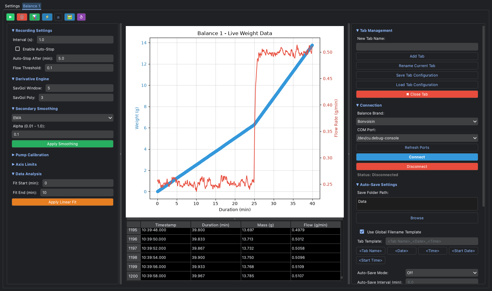

# Balance Streamer

[](https://github.com/brandonbtm29/Balance-Streamer-GUI/actions/workflows/ci.yml)

A desktop app that reads several laboratory balances at once over RS-232/USB, turns the mass
readings into a live flow rate, and saves each run to Excel.



*Screenshot made with simulated data: a pump running at 0.25 g/min, stepped up to 0.5 g/min at 25 minutes.*

## Why

When a pump feeds a column, the easiest honest measure of flow is the mass of liquid that comes out.
Balance Streamer logs that mass every second (or at any interval you choose) from one or more
balances, and shows the flow rate as it happens, so you can see a pump drift or a column clog while
the run is still going. It was built for column experiments in a polymer engineering lab.

## Features

- **Several balances at once**: one tab per balance, each with its own connection, chart and settings.
- **Live flow rate**: mass and flow rate (g/min) on one chart, plus a table of every reading.
- **Choice of smoothing**: a Savitzky-Golay derivative, then Mean, Median, EMA, Butterworth, or an
  Adaptive filter that matches its window to your peristaltic pump's speed and roller count.
- **Excel export**: one `.xlsx` per run with a Documentation sheet (balance, port, notes, your metadata),
  a Data sheet and a chart. File names come from a template built from tokens, for example
  `<Start Date> <Start Time> Flow rate <Material>`, where `<Material>` is a token you add yourself.
- **Auto-save and auto-stop**: save every few minutes, or stop and save when the flow drops below a
  threshold for a set time. Quick Save overwrites the last file without asking.
- **Crash protection**: every reading is also written to a backup CSV straight away. If the computer
  crashes or loses power, Recover Session brings the run back. Backups older than 30 days are deleted.
- **Tare, linear fit and pump calibration** from the side panels.
- **Dark or light theme**, and panels you can collapse and reorder.

## Supported balances

| Balance | How it reads | Set the balance to |
|---|---|---|
| Mettler Toledo | Asks for a reading (MT-SICS `SI`) | 9600 baud, host mode |
| Ohaus Adventurer | Asks for a reading (`IP`) | 9600 baud |
| Bonvoisin | Listens to continuous output | 9600 baud, continuous print |
| Lachoi | Listens to continuous output | 9600 baud, continuous print |

All connections use 9600 baud, 8 data bits, no parity, 1 stop bit. Other balances that print a
number and a unit on each line usually work with the Bonvoisin or Lachoi setting. The app's
**Settings → Help & About** page has menu paths for setting up common balances.

## Install

You need **Python 3.11 or newer** ([python.org](https://www.python.org/downloads/)) and a USB or
RS-232 cable for each balance.

1. Download the code: **Code → Download ZIP** on GitHub, or
   ```bash
   git clone https://github.com/brandonbtm29/Balance-Streamer-GUI.git
   cd Balance-Streamer-GUI
   ```
2. Create a virtual environment and install:

   **Windows**
   ```bat
   python -m venv .venv
   .venv\Scripts\python -m pip install -r requirements.txt
   ```
   **macOS**
   ```bash
   python3 -m venv .venv
   .venv/bin/python -m pip install -r requirements.txt
   ```
3. Start it by double-clicking `Launch_Windows.bat` (Windows) or `Launch_Mac.command` (macOS).
   You can also run `python multi_balance_stream.py` with the virtual environment active.

If your computer doesn't list the balance's port, install the driver for your USB-serial adapter
(for example FTDI).

## Using it

1. Plug in the balance and set it up as in the table above.
2. In the balance tab, pick the **Balance Brand** and **COM Port** (Refresh Ports if it's missing),
   then **Connect**.
3. Press **▶** to start recording. Press it again to stop.
4. Press the Excel button to save, or set up **Auto-Save Settings** so it saves for you.
5. Add a tab for each extra balance with **Tab Management → Add Tab**.

The buttons across the top of each balance tab, left to right (hover over one to see its name):

| Button | What it does |
|---|---|
| Start / Stop Recording | Start or stop logging readings |
| Clear Data | Clear the readings in this tab and start a new run |
| Save to Excel | Save the run to Excel (asks where) |
| Quick Save | Overwrite the last saved file without asking |
| Tare Balance | Send a tare command (`T`) to the balance |
| Save Graph PNG | Save the chart as an image |
| Recover Session | Restore a run from the backup files |

## Where files go

The app keeps its code and its data apart:

- **Data folder**: `~/SyncThing/UAkron Playground/Balance Streamer Application/` by default.
  The app works inside this folder, so exports land in `Data/` and backups in `Data Backups/`.
  Set the `UAKRON_APP_DATA_DIR` environment variable to use another folder (or `UAKRON_DATA_DIR`
  to move the parent folder).
- **Settings** (`config.json`): in the app's own folder by default. In
  **Settings → Application Settings → Settings Folder** you can move them, for example into the data
  folder so several computers share them. `UAKRON_SETTINGS_DIR` overrides this.

Neither data nor settings are ever stored in the repository; both are in `.gitignore`.

## Build a standalone app

```bash
python build_app.py
```

This uses PyInstaller to make `dist/Balance_Streamer/`, which runs without Python installed.
Build on the system you want to run it on (Windows for an `.exe`, macOS for a Mac app).

## Good to know

- The flow rate assumes the liquid is collected on the balance. It is reported in g/min; convert
  to mL/min with your liquid's density.
- A balance tab only records while you press ▶. Being connected isn't enough.
- Closing a tab forgets its saved connection settings.
- The theme library (`pyqtdarktheme`) is pinned to 0.1.7, the only version that installs on
  Python 3.12 and newer.

## Development

```bash
python -m pip install -e ".[dev]"
pytest              # headless Qt tests: parsers, flow rates, Excel export
ruff check .
ruff format .
```

The tests point the app at a temporary data folder, so they never touch your real data. CI runs
them on Windows, macOS and Linux with Python 3.11 to 3.13, and scans the history for secrets.

The version number lives in one place: `__version__` in `multi_balance_stream.py`. Changes are
listed in [CHANGELOG.md](CHANGELOG.md).

## How this was built

Balance Streamer is written and maintained by Brandon T. McReynolds with the help of AI coding
assistants. Earlier versions (before October 10, 2026) were co-developed with Google Gemini in
Antigravity. Later versions were co-developed with Claude (Anthropic); those commits list Claude as a
co-author. Brandon directs the work, reviews and tests the changes, and is responsible for the
project.

## License

[MIT](LICENSE)
